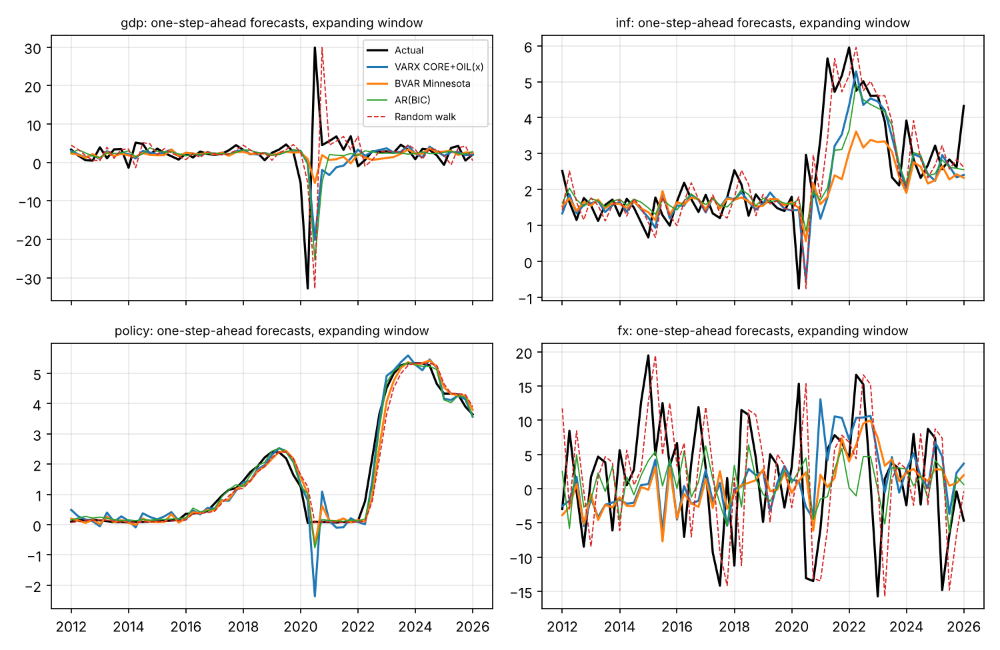

# Macro VAR

What forecasts US growth, inflation and interest rates one quarter or one year ahead, once the
models are not allowed to see the future? Across more than 1,000 model specifications, nothing
reliably beats the simplest forecast: each series predicted from its own past.

Nicholas Hong, Nanyang Technological University

## What I built

- A specification search for a vector autoregression (VAR: a model where each variable is
  forecast from the recent past of all the variables). It adds candidate variables block by block
  and rejects any specification that fails hard validity gates, then compares five estimator
  classes on the winner.
- An independent second implementation of the winning model that checks the published numbers
  and adds a Bayesian VAR, diagnostics and impulse responses.
- A permutation study that runs 1,014 VARX models (a VAR with outside variables, such as an oil
  shock, added as inputs) through an expanding walk-forward, including a replication on data as
  it was first published.

| Study | Paper |
|---|---|
| Disciplined specification search and model-class evaluation (repository root) | [`papers/01_var_selection_horserace.pdf`](papers/01_var_selection_horserace.pdf) |
| A permutation study of VARX forecasting models (`studies/varx_permutation_study/`) | [`studies/varx_permutation_study/paper/varx_permutation_study.pdf`](studies/varx_permutation_study/paper/varx_permutation_study.pdf) |

## Data

All public and keyless: FRED, FRBSF (total factor productivity), the New York Fed's HLW
natural-rate estimates, and ALFRED, which keeps each series as it was first published. Each study
ships its result tables and figures and can be re-executed.

## Method

- Forecasts are made out of sample: at each forecast origin the model is fitted only on data
  available up to that quarter. Accuracy is relative RMSE, a model's typical forecast error
  divided by the benchmark's, so values below 1 beat the benchmark.
- The specification search is greedy and theory-pruned: it adds one variable block at a time and
  keeps the best, but a specification is eligible only if it is stable, has enough observations
  per parameter (the parsimony gate, T/k) and leaves residuals with no remaining
  autocorrelation (the whiteness gate).
- The five estimator classes are OLS, a Minnesota Bayesian VAR (shrinks coefficients toward a
  random walk), ridge, LASSO and elastic-net.
- The Model Confidence Set is a test that keeps every model that cannot be shown worse than the
  best; if a simple model stays in the set, nothing has been shown to beat it.
- Forecast comparisons use Clark-West and Diebold-Mariano tests, which ask whether one model's
  forecast errors are significantly smaller than another's.

## Main result

Specification search. A theory-pruned block forward search with hard validity gates selects a
four-variable core plus oil as the honest baseline, and no estimator (OLS, Minnesota BVAR, ridge,
LASSO, elastic-net) is distinguishable from a univariate AR by the Model Confidence Set.

The greedy forward path, before the validity gates are applied, runs 1.0431 (`CORE`) → 0.9452
(`CORE+WEALTH`) → 0.9117 (`CORE+WEALTH+OIL(x)`) in mean relative RMSE at h=1. Neither wealth
specification is admissible: `CORE+WEALTH` fails the parsimony gate (T/k = 2.29) and
`CORE+WEALTH+OIL(x)` fails both parsimony (T/k = 2.10) and residual whiteness (p = 0.044). The
eligible winner, used throughout the paper, is `CORE+OIL(x)` at 0.9679 (h=1) and 0.8786 (h=4).
The rejected 0.9117 is reported because it is the best raw score in the run: it is the case where
the hard filters overrule out-of-sample RMSE, which is the point of this study. Full
per-specification detail is in `results/reproduce_results.json` (`phaseA_table`).


The heatmap is drawn from the 57-origin run in `results/var_horserace_results.csv`, where the
winner scores 0.9657 at h=1. The text uses the 54 origins common to both horizons (0.9679).

Look-ahead in a standard filter. The Hodrick-Prescott (HP) filter splits a series into trend and
cycle. Run once on the full sample, it uses future data. For the policy rate, the two-sided cycle
differs from the real-time one by 0.86 points on average, 80% of the cycle's own standard
deviation. Over the last eight quarters the gap is 65.8%, a figure that moves by tens of points
with the quarter the sample ends in (`src/demo_hp_lookahead.py` gives 24% to 62% for end quarters
from 2025Q2 to 2026Q2). Year-over-year transforms fail every whiteness test.

VARX permutation study. 1,632 specifications (544 cells under three lag rules) and 1,014 unique
models in an expanding walk-forward from 2009Q4. Exogenous shocks buy a ~12% GDP RMSE gain at h=1
that is mostly COVID and mostly noise (4.0% of specs beat the core at the 5% level, what chance
delivers). The gain survives ALFRED real-time vintages. Externally identified shocks (Kaenzig oil,
Bauer-Swanson FOMC) do not beat cheap growth-rate proxies. In the predictive density the shock
model is overconfident until future-shock risk is priced, after which it is no sharper than the
pure VAR.

## What didn't work

- No estimator beats a univariate autoregression: the Model Confidence Set cannot separate them.
- The winner is chosen and scored on the same out-of-sample window, with the lag length fixed at
  2, so 0.9679 is the best eligible score of the search and has not been tested on fresh data.
- The Minnesota BVAR in the cross-check averages 0.901 at h=1 against the OLS VARX's 0.966,
  mostly from GDP and the policy rate, but no target beats the OLS VARX in a Diebold-Mariano test
  (p from 0.18 to 0.81). It is worse on inflation.
- The full-sample VARX(2) is stable (largest root 0.89) but rejects normality and White
  homoskedasticity, and shows lag-1 serial correlation (LM p = 0.034). Johansen finds no
  cointegration with an intercept (case 3) and one vector with no deterministic terms, so the
  no-VECM choice depends on the trend case.
- The shock models' 12% gain at h=1 is mostly COVID, and identified shocks add nothing over
  growth-rate proxies.

## What I learned

<!-- TODO Nick: three bullets in your own words. -->

- 
- 
- 

## How to run

```
pip install -r requirements.txt
python src/reproduce.py            # specification search; pulls FRED + FRBSF TFP if not cached in fred_data/, seed 20260710
cd studies/varx_permutation_study/src && python fetch_data.py && python run_study.py   # permutation study
```

Every runner resolves its paths from its own file location, so they work from any working
directory (override the root with `REPRO_ROOT`). Re-runs write to `fred_data/`, `repro/` and
`outputs/`, all gitignored, so nothing regenerated overwrites the committed tables in `results/`,
the charts in `figs/`, or the typeset figures in `papers/var_selection_horserace/figs/`.
`src/reproduce.py` puts its three paper figures in `outputs/figs/`. The permutation study's
`run_study.py` reproduces the full walk-forward in well under a minute; its extensions (real-time,
identified shocks, combination, density, Bayesian coverage) run in seconds against cached data.
A self-contained interactive console is in `dashboard/dashboard.html`. See
`studies/varx_permutation_study/README.md`.

Reproduction record. Re-executed on 2026-08-21 against a fresh FRED pull: the specification
search (eligible winner `CORE+OIL(x)`, and the same greedy path and gate rejections above) and the
model-class table reproduced. The HP revision statistic moved from 65.8% to 66.3% and the
Johansen trace in the second decimal. The HP move comes from where the sample ends: the federal
funds rate is not revised, the fresh pull had one more month of data, and the statistic is about
five points lower when the sample ends one quarter earlier. A rerun on 17 November 2026 from a
later cache gives the same search result and differs from the model-class table in the fourth
decimal on the wide models. `results/reproduce_results.json` records the library versions of the
reference run (numpy 2.4.4, pandas 3.0.2, statsmodels 0.14.6, scikit-learn 1.8.0, arch 8.0.0);
those exact pins are in `requirements-reference.txt`, so `pip install -r
requirements-reference.txt` rebuilds the reference environment. `requirements.txt` is the loose
everyday set. The permutation study was re-executed end to end on 2026-08-21 (1,014 models, 38 s;
all 31 paper statistics identical) and again on 2026-08-23 (1,014 models, 63,918 result rows,
36 s).

### Cross-check

`src/crosscheck_study1.py` is a separate implementation of the eligible winner and the CORE
anchor, extended with a Minnesota BVAR in the same loop, unit roots, Johansen under three trend
cases, full residual diagnostics, IRFs, FEVD, historical decomposition and a GLP-style BVAR.
Outputs are in `results/crosscheck/`. Scored on the paper's window it returns the published
numbers to four decimals: 0.9679 / 0.8786 for `CORE+OIL(x)` and 1.0431 / 0.9318 for `CORE`, with
identical Clark-West statistics. `reproduce.py` scores both horizons on the 54 common origins;
`reproduce_results.json` used to report 57 for h=1 and now reports 54. On all 57 h=1 origins the
winner scores 0.9656. The Minnesota BVAR uses lambda 0.1 and a prior mean of 1 on the policy
rate's own lag. `docs/eviews_spotchecks.md` lists EViews commands, with expected values, for
checking the same model in a second package.



## Repository layout

```
src/            var_horserace.py (forward-selection runner; --spec base | augmented |
                reer_yoy | allyoy), var_horserace_gap.py (gap-vs-level), phase2_modelclass.py
                (OLS, BVAR, Ridge, LASSO, ElasticNet), figure builder, reproduce.py (single-seed
                driver that regenerates every number in the paper)
results/        executed outputs for the four specifications, gap-vs-level and phase 2 (an
                earlier 127-quarter run), plus reproduce_results.json (128 quarters)
figs/           relative-RMSE heatmaps, winner forecasts, HP look-ahead, gap-vs-level
docs/           methodology note
papers/var_selection_horserace/   LaTeX source and figures
studies/varx_permutation_study/   the permutation study: code, results, paper
```

## What the two studies agree on

1. Parsimony and leakage-free evaluation matter more than estimator sophistication in short macro
   samples.
2. Reduced-form forecasting does not reward structural identification; cheap proxies do that job
   as well.
3. The results are mostly nulls, and every number here was reported as it came out.

Nicholas Hong | Built for educational and research purposes. Not financial advice.
